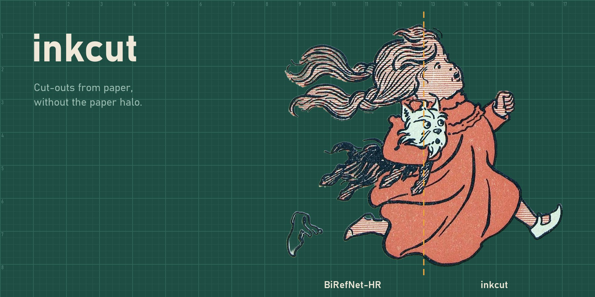
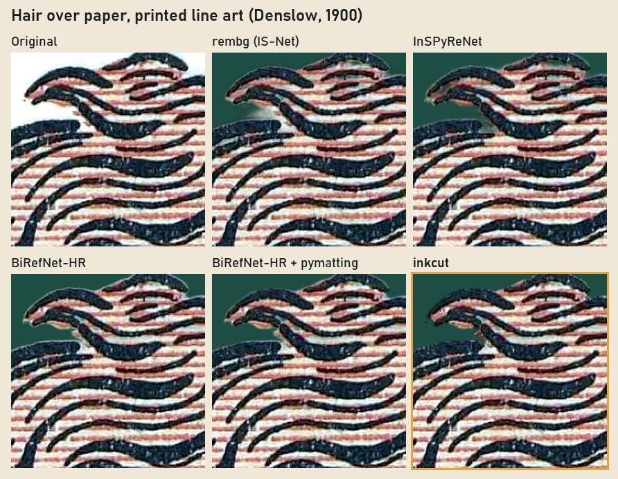
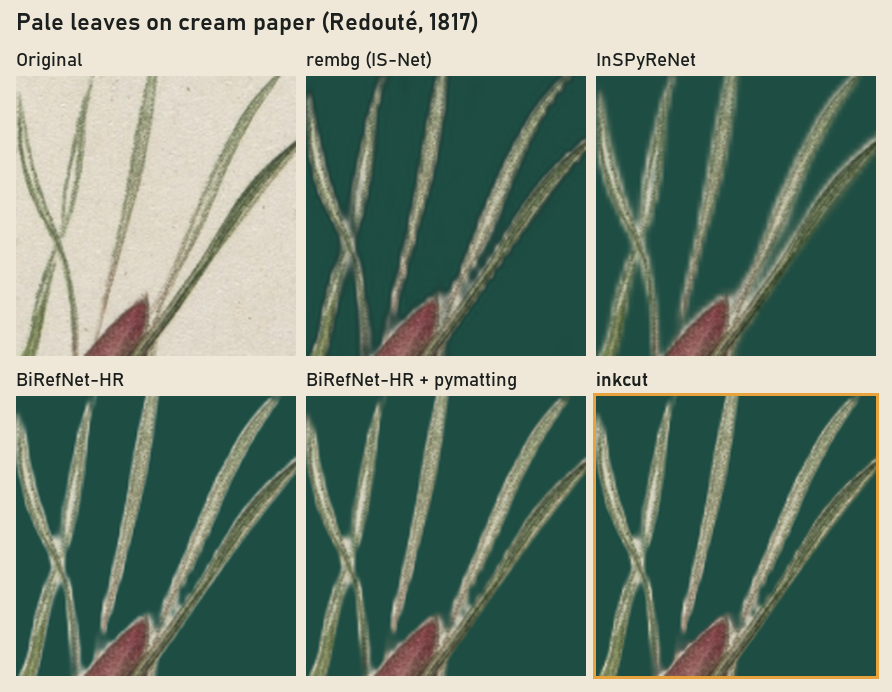
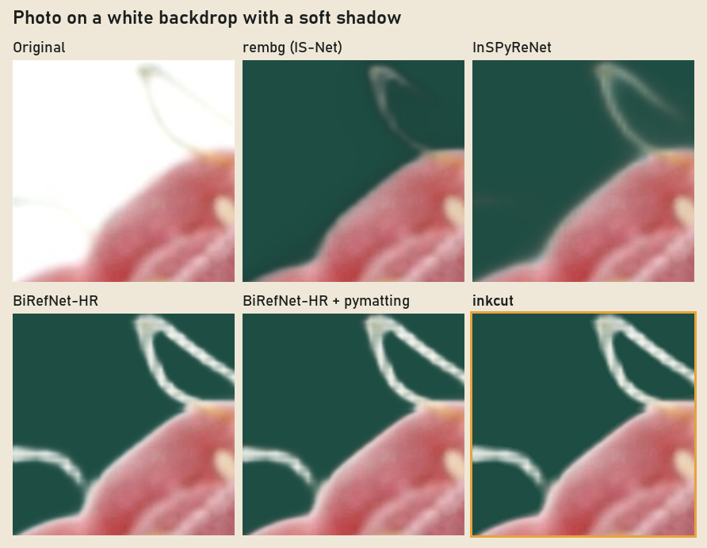

<p align="center">
  
</p>

# inkcut

Background removal for drawings, prints, scans and photos that sit on a flat background.

inkcut runs [BiRefNet-HR](https://huggingface.co/ZhengPeng7/BiRefNet_HR) to find the subject, then uses one fact the model does not: the background is a single known colour. That makes it possible to work out, for every pixel along the edge, how much of it is subject and how much is paper, and to take the paper out.

## Why

Segmentation models are good at finding the subject. Their soft edges still carry the background, though. Drop the cut-out onto a dark page and a pale rim shows up around every line, and the thin gaps of paper between strands of hair stay filled in. Colour fixes such as foreground estimation recolour those pixels but have to guess the background. On a scan or a studio shot the background is not a guess: it is right there, one flat colour, and inkcut solves against it exactly.

## Install

```
pip install git+https://github.com/aaljman/inkcut
```

Python 3.9 or newer with PyTorch. The model (BiRefNet-HR, 444 MB, MIT) downloads from Hugging Face the first time you run inkcut.

## Use

```
inkcut drawing.png                  # writes drawing_cut.png next to it
inkcut scans/ -o cutouts/           # every image in a folder
inkcut photo.jpg --preview          # also writes photo_preview.png: original, model, inkcut
inkcut drawing.png --gpu            # run the model on CUDA
inkcut drawing.png --mask mask.png  # skip the model and clean a mask from any other tool
```

| Option | What it does |
| --- | --- |
| `-o DIR` | Write results to `DIR` instead of next to each input. |
| `--gpu` | Run BiRefNet-HR on CUDA. On the CPU an image takes about 45 seconds. |
| `--mask FILE` | Use your own alpha mask (a grayscale image) for a single input. |
| `--preview` | Save a side-by-side check: original, plain model cut, inkcut. |
| `--plain`, `--save-mask` | Also save the plain model cut and the model's mask. |
| `--no-clean` | Plain BiRefNet-HR cut, no cleanup. |
| `--model-dir DIR` | Load the model files from a folder instead of downloading them. |
| `--set KEY=VALUE` | Override a cleanup setting (see `inkcut/cleanup.py`). |

From Python, `clean` takes the image and any mask:

```python
import numpy as np
from PIL import Image
from inkcut import clean

src = np.asarray(Image.open("drawing.png").convert("RGB"), dtype=np.float32)
mask = np.asarray(Image.open("mask.png").convert("L"), dtype=np.float32) / 255

rgb, alpha, info = clean(src, mask)   # rgb is None if the background is not flat
if rgb is not None:
    cut = np.dstack([rgb, alpha * 255]).round().astype(np.uint8)
    Image.fromarray(cut, "RGBA").save("drawing_cut.png")
```

## How it works

1. **Read the background.** The colour of everything the model calls background. One flat colour works, and so does a smooth change across it: a soft shadow, a vignette, aged paper. A real scene behind the subject is detected, and that image is left exactly as the model cut it.
2. **Tell line art from everything else.** If most of the subject's outline is traced by a dark ink line, the image is treated as line art. Photos, paintings and engravings are not.
3. **Clean every edge.** Each soft edge pixel is split into subject colour and paper, and the paper is removed. In line art the pixels outside the ink outline also get their transparency re-solved, which removes the halo itself.
4. **Line art only: the paper the model kept.** Thin gaps of paper between ink lines, paper caught between an ink line and a colour, and paint that spilled past the outline onto the paper.

Wide white areas (eye whites, white cloth), paint that is whiter than the paper, and printed textures where the paper is part of the colour (hatching, line screens, halftone dots) are left alone.

## Compared with other tools

Each crop is a cut-out laid on the same green. Pale edges are paper that came along with the subject.

<p align="center"></p>

<p align="center"></p>

<p align="center"></p>

On photos and paintings inkcut keeps the model's outline and only cleans the colour of the edge, so the gain there is small and safe. The large gains are on ink drawings, prints and scans.

## Benchmark

There is no standard benchmark for cutting subjects off flat backgrounds, so this one follows the Composition-1k recipe: 100 photos from [AIM-500](https://github.com/JizhiziLi/AIM), picked with a fixed seed, each with its hand-labelled alpha matte, composited onto white. Alpha is scored with the usual matting measures. Colour is scored by laying both the cut-out and the ground truth on dark grey and measuring the difference around the edges, which is where a pale fringe shows. Lower is better everywhere.

| Method | SAD | MSE ×10³ | Gradient | Re-composite |
| --- | ---: | ---: | ---: | ---: |
| rembg (U2-Net) | 62.34 | 25.72 | 0.37 | 16.80 |
| rembg (IS-Net) | 44.02 | 15.64 | 0.17 | 13.16 |
| InSPyReNet | 14.50 | 2.93 | 0.09 | 8.09 |
| BiRefNet-HR | 9.20 | **0.95** | **0.04** | 8.97 |
| BiRefNet-HR + pymatting | 9.20 | **0.95** | **0.04** | **5.38** |
| inkcut | **9.03** | 0.97 | **0.04** | 5.64 |

How to read it:

- These are photographs, so inkcut keeps the model's outline for all but the 5 it read as line art. Its alpha ends up level with BiRefNet-HR: a little better on SAD, a little worse on MSE.
- On edge colour, pymatting's foreground estimate scores better than inkcut's. One caveat: AIM-500 has no separate foreground layer, so the ground-truth colours were themselves estimated with pymatting, which favours it.
- The test cannot show inkcut's main job, removing the paper around ink lines, because it has no drawings in it. The comparisons above do.

To reproduce it from a copy of AIM-500 (its `original` and `mask` folders):

```
python bench/prep.py AIM-500 test 100 0 255,255,255
inkcut test/src -o test/out --plain --save-mask
python bench/run_others.py test/src test/out
python bench/score.py test test/out
```

## Limits

- The background has to be flat, or change smoothly. Anything busier is passed through untouched.
- A white subject on a white background cannot be told apart by colour. inkcut keeps whatever the model decided there.
- In line art, a fill that is almost exactly the paper colour can come out lighter than intended.
- The outermost tips of a printed texture (a line screen running off the edge of a figure) can lose a pixel or two.
- On a CPU, BiRefNet-HR at 2048 px takes about 45 seconds per image. Use `--gpu` if you have CUDA.

## Credits

- **BiRefNet** by Peng Zheng, Dehong Gao, Deng-Ping Fan, Li Liu, Jorma Laaksonen, Wanli Ouyang and Nicu Sebe, MIT license. [Paper](https://arxiv.org/abs/2401.03407), [code](https://github.com/ZhengPeng7/BiRefNet).
- **AIM-500** by Jizhizi Li, Jing Zhang and Dacheng Tao, used for the benchmark under its release agreement. Only scores are published here, never the images. Li, Zhang and Tao, "Deep Automatic Natural Image Matting", IJCAI 2021.
- **Example images**, all public domain or CC0, via Wikimedia Commons:
  W. W. Denslow, [illustration for *The Wonderful Wizard of Oz*](https://commons.wikimedia.org/wiki/File:The_Wonderful_Wizard_of_Oz_Book_-_p309b.jpg) (1900, public domain);
  Pierre-Joseph Redouté, [*Rosa Hudsoniana Salicifolia*, Les Roses](https://commons.wikimedia.org/wiki/File:Henry_Joseph_Redout%C3%A9_-_Les_Roses-_Rosa_Hudsoniana_Salicifolia_-_1965.292_-_Cleveland_Museum_of_Art.jpg) (1817, Cleveland Museum of Art, CC0);
  Petr Kratochvil, [*Three Raspberries*](https://commons.wikimedia.org/wiki/File:Three_Raspberries.jpg) (CC0).

## License

MIT, see [LICENSE](LICENSE). BiRefNet-HR is MIT as well.
